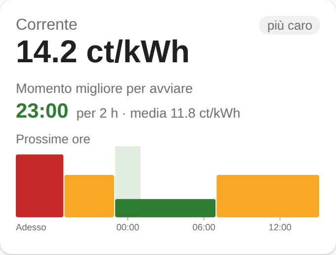

# Corrente ⚡

**Your real electricity price in Home Assistant — and the best time to switch things on. Made for Italy 🇮🇹 and Switzerland 🇨🇭.**

> 🚧 Pre-release. The first public version (v0.1) is planned for mid-November 2026.

<p>
  
  
</p>

## What it does

- **Price now**, the **next change** and the **next price**, from your own contract or your grid operator's tariffs.
- **Best time to start** a 2-hour appliance (dishwasher, washing machine, boiler) in the next 24 hours.
- A **dashboard card** the whole household can read: price now, the next 24 hours in colours, the best time to start.
- Set up entirely from the UI. No YAML. Everything is computed locally; the only network calls are to public, official data.
- Interface in English, Italiano, Deutsch and Français. 🇮🇹 [Guida in italiano](docs/guida-it.md).

### 🇮🇹 Italy
- Time bands **F1 / F2 / F3** as defined by ARERA, national holidays included (ARERA's closed list — 4 October is *not* F3).
- Contracts: single price (*monoraria*), two bands F1/F23 (*bioraria*), three bands (*trioraria*).
- Coming next: PUN Index GME and PUN-indexed contracts.

### 🇨🇭 Switzerland
- Type your **municipality**: Corrente finds your **grid operator** in ElCom's open data and reads the tariff file every operator must publish (Art. 7b StromVV).
- High/low tariff windows, cantonal and municipal surcharges, federal charges (grid surcharge, electricity reserve, Swissgrid system services) and VAT — checked against ElCom's published totals.
- Follows your operator into the new year by itself.
- Works for most operators, Ticino included (AIL Lugano, AIM Mendrisio, AEM Massagno…). If your operator has not published a readable file, you can paste the link — or [tell us](../../issues/new/choose) and we add it.
- Coming next: dynamic tariffs (EKZ, CKW, Groupe E, BKW).

## Installation

Corrente will be in the default HACS store after the launch. Until then:

1. HACS → ⋮ → **Custom repositories** → add `https://github.com/MichaelPito/ha-corrente`, category **Integration**.
2. Install **Corrente** and restart Home Assistant.
3. **Settings → Devices & services → Add integration → Corrente**, then follow the steps (country, then your contract or your municipality).

## Sensors

| Sensor | Italy | Switzerland |
|---|---|---|
| Price now | €/kWh | CHF/kWh incl. VAT |
| Time band / Tariff period | F1, F2, F3 | single, high, low |
| Next band change / Next price change | ✅ | ✅ |
| Next band | ✅ | — |
| Next price | ✅ | ✅ |
| Best time to start (2 h) | ✅ | ✅ |
| Fixed charges per month | — | ✅ |
| Cost today / Cost this month ¹ | € (energy part) | CHF incl. VAT |

¹ Optional: in the integration's options choose your **energy meter** (any kWh sensor, e.g. your smart meter or the energy dashboard's grid consumption). Each kWh is priced at the moment it is used.

The price sensor also carries the price **schedule** for the next 36 hours and the best window (`best_start`, `best_end`, `best_average_price`) as attributes.

## The card

The card is installed with the integration. Add it from the dashboard editor (search "Corrente") or with YAML:

```yaml
type: custom:corrente-card
entity: sensor.corrente_price_now
```

## Blueprint: start an appliance at the cheapest time

Load the dishwasher, turn on a "ready" helper, and Corrente starts it at the best time.

[](https://my.home-assistant.io/redirect/blueprint_import/?blueprint_url=https%3A%2F%2Fgithub.com%2FMichaelPito%2Fha-corrente%2Fblob%2Fmain%2Fblueprints%2Fautomation%2Fcorrente%2Fstart_at_best_time.yaml)

## Automation example

Start the dishwasher at the best time (assuming a smart plug or a dishwasher integration):

```yaml
automation:
  - alias: "Dishwasher at the cheapest time"
    triggers:
      - trigger: time
        at: sensor.corrente_best_time_to_start_2_h
    actions:
      - action: switch.turn_on
        target:
          entity_id: switch.dishwasher
```

## Data sources

- **Switzerland:** ElCom open data (LINDAS, Open-Use licence) and the tariff files published by grid operators. Federal charges per year are documented in [`docs/FONTI-DATI.md`](docs/FONTI-DATI.md).
- **Italy:** ARERA time-band definitions (TIV, Tabella 6). Prices come from your contract.

## Suggestions and requests

Something missing? Your provider or tariff not covered? **[Open a request](../../issues/new/choose)** — it takes a minute, and the most requested ideas go to the top of the [roadmap](docs/ROADMAP.md).

## Support the project

Corrente is free and open source. If it saves you money, you can [buy us a coffee ☕](https://buymeacoffee.com/michaelpito).

## Transparency

Corrente is developed with the help of AI (Claude by Anthropic) and checked by automated tests against real tariff files. Replies on issues may be AI-assisted and are labelled as such.

## License

[MIT](LICENSE)
