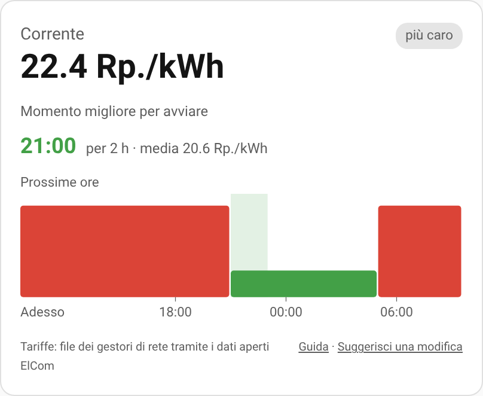
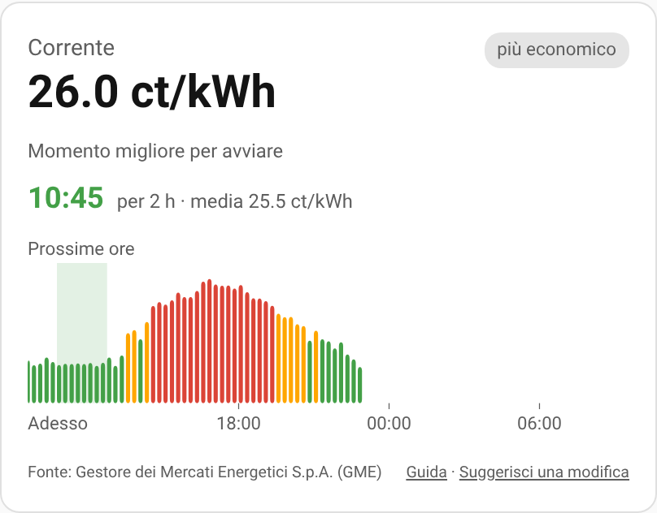
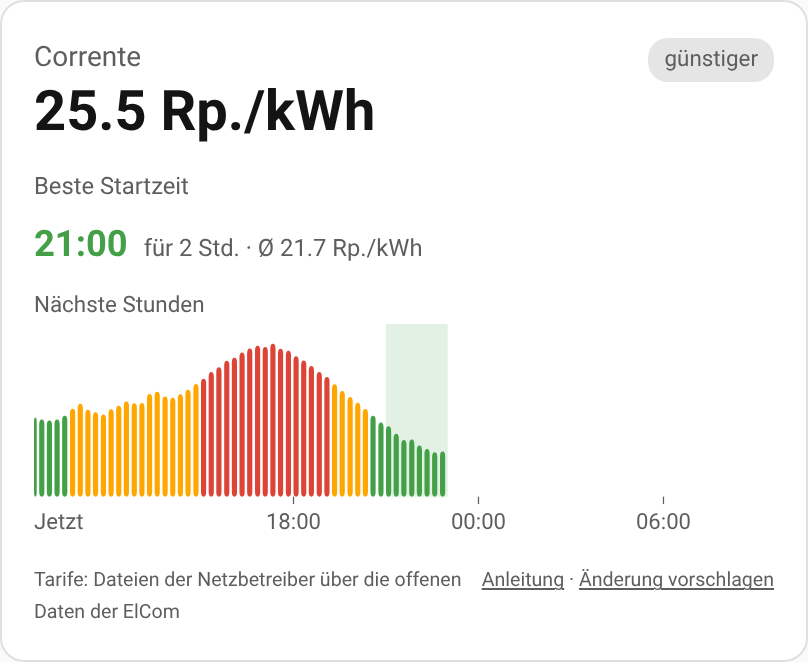
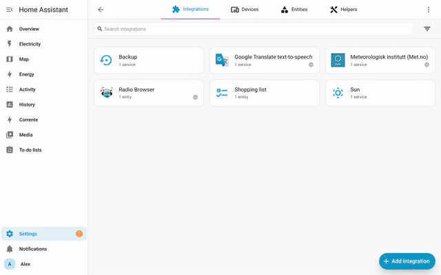
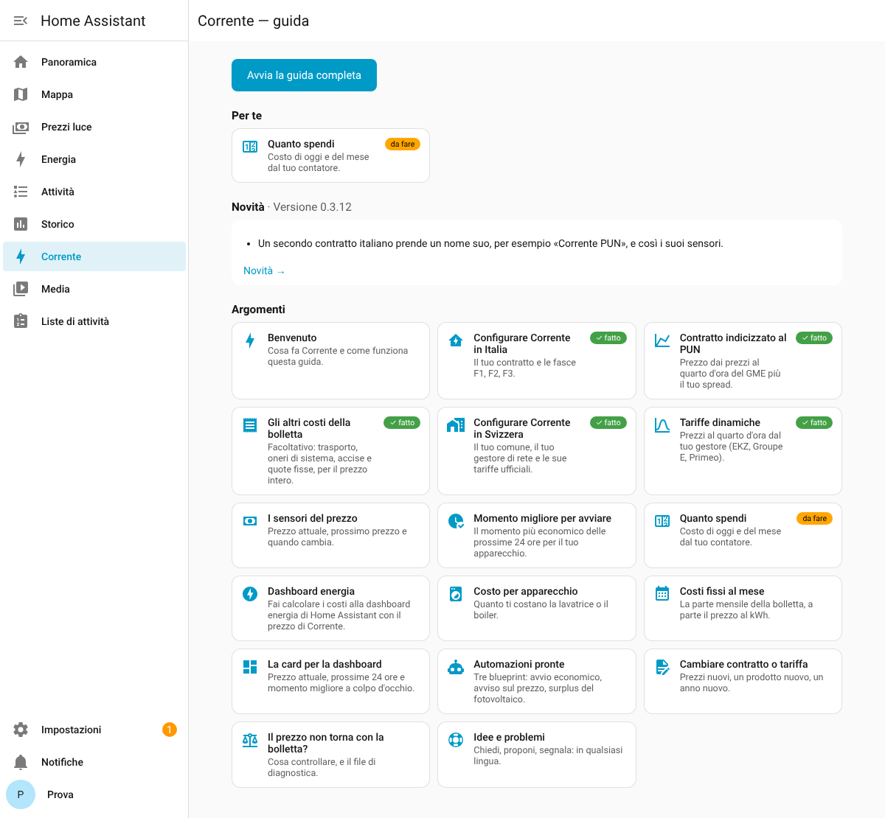

<picture>
  <source media="(prefers-color-scheme: dark)" srcset="custom_components/corrente/brand/dark_logo.png">
  
</picture>

# Corrente ⚡

**Your real electricity price in Home Assistant — and the best time to switch things on. Made for Italy 🇮🇹 and Switzerland 🇨🇭.**

> Requires Home Assistant 2025.10 or later (tested on 2025.10 and 2026.10.4; checked on 2026.11.0). What's new in each version: [CHANGELOG](CHANGELOG.md).

<p>
  
  
  
</p>

## What it does

- **Price now**, the **next change** and the **next price**, from your own contract or your grid operator's tariffs.
- **Best time to start** an appliance (dishwasher, washing machine, boiler, electric car) in the next 24 hours — 2 hours by default, adjustable in the options.
- A **dashboard card** the whole household can read: price now, the next 24 hours in colours, the best time to start.
- Set up entirely from the UI. No YAML. Everything is computed locally; the only network calls are to public, official data.
- Interface in English, Italiano, Deutsch and Français. 🇮🇹 [Guida in italiano](docs/guida-it.md).

### 🇮🇹 Italy
- Time bands **F1 / F2 / F3** as defined by ARERA, national holidays included (ARERA's closed list — 4 October is *not* F3).
- Contracts: single price (*monoraria*), two bands F1/F23 (*bioraria*), three bands (*trioraria*), and **PUN-indexed** (PUN Index GME or your zone + spread, optional grid losses) with quarter-hour prices for today and tomorrow.
- Optional: the other costs on your bill — transport, system charges and excise per kWh, and the fixed charges per month — so the price and the costs match your bill, not just the energy part.

### 🇨🇭 Switzerland
- Type your **municipality**: Corrente finds your **grid operator** in ElCom's open data and reads the tariff file every operator must publish (Art. 7b StromVV).
- High/low tariff windows, cantonal and municipal surcharges, federal charges (grid surcharge, electricity reserve, Swissgrid system services) and VAT — checked against ElCom's figures for your municipality. Fees missing from your operator's file are taken from ElCom (shown in the price sensor's attributes). The fixed charges per month include metering, which most operators list as a tariff of its own: it is taken from ElCom (about 6 CHF a month).
- Checked before release against ElCom for every operator with a readable tariff file (about 340 of 535 for 2027): the grid price matches within 0.6 Rp/kWh for 95% of them.
- Follows your operator into the new year by itself.
- Works for most operators, Ticino included (AIL Lugano, AIM Mendrisio, AEM Massagno…). Corrente also follows the web page your operator registered with ElCom to the tariff file it links to. If your operator has not published a readable file, you can paste the link — or [tell us](../../issues/new/choose) and we add it.
- **Dynamic tariffs** with prices per quarter hour, read from the operator's own API when its tariff file names one (VSE / SmartGridready standard): EKZ *Energie Dynamisch* and *Netz 400D*, Groupe E *Vario*, Primeo *NetzDynamisch* (Basel-Landschaft, Solothurn), and any other operator using the standard with public prices. Today's prices, and tomorrow's as soon as the operator publishes them.

## Installation

Corrente will be in the community catalog after the launch: the **Marketplace** built into Home Assistant from 2026.11 (**Settings → Marketplace**), and **HACS** on earlier versions. Until then:

1. Add Corrente's link `https://github.com/MichaelPito/ha-corrente`:
   - **Marketplace** (Home Assistant 2026.11 and later): **Settings → Marketplace → Add from link**, paste the link, **Add**. The first time, the Marketplace asks you to connect a GitHub account (it only reads public information).
   - **HACS** (earlier versions): **⋮ → Custom repositories**, paste the link, type **Integration**.
2. Install **Corrente** and restart Home Assistant.
3. **Settings → Devices & services → Add integration → Corrente**, then follow the steps (country, then your contract or your municipality). Or:

   [](https://my.home-assistant.io/redirect/config_flow_start/?domain=corrente)

<p></p>

Without the Marketplace or HACS: download `corrente.zip` from the [latest release](../../releases/latest), unzip it into `config/custom_components/corrente/` and restart Home Assistant.

## The guide in Home Assistant

After the setup, **Corrente** appears in the sidebar: a guide that shows what you can do and how, marks what you have already set up, and suggests what is left. Pick a topic or follow the full guide step by step; after each update it shows what is new. English, Italian, German and French.

<p></p>

## Sensors

| Sensor | Italy | Switzerland |
|---|---|---|
| Price now | €/kWh | CHF/kWh incl. VAT |
| Time band / Tariff period | F1, F2, F3 | single, high, low ² |
| Next band change / Next price change | ✅ | ✅ |
| Next band | ✅ (fixed contracts) | — |
| Wholesale price (PUN / zone) | ✅ (PUN contracts) | — |
| Next price | ✅ | ✅ |
| Best time to start | ✅ | ✅ |
| Fixed charges per month | ✅ (if entered) | ✅ |
| Cost today / Cost this month ¹ | € (energy part, or all per-kWh costs if entered) | CHF incl. VAT |
| Cost per appliance ³ | € (as above) | CHF incl. VAT |

² With a dynamic tariff, *high* means above the day's average price.

¹ Optional: in the integration's options choose your **energy meter** (any kWh sensor, e.g. your smart meter or the energy dashboard's grid consumption). Each kWh is priced at the moment it is used. No such sensor yet? [How to read your consumption](docs/meter.md) (clamp, Italian Open Meter / Chain 2, Swiss smart-meter interface).

³ Optional: in the options choose **Cost per appliance** and pick the energy sensors of appliances with their own meter (for example a smart plug under the washing machine). Each one gets *Cost today — name* and *Cost this month — name*.

**Energy dashboard:** in its grid consumption, choose *Use an entity with the current price* and pick Corrente's **Price now**: Home Assistant then counts the cost of each kWh at the price of that moment.

The price sensor also carries the price **schedule** for the next 36 hours and the best window (`best_start`, `best_end`, `best_average_price`) as attributes.

## The card

The card is installed with the integration. After setting up Corrente for the first time, **reload the page** in your browser once so it finds the card. Then add it from the dashboard editor (search "Corrente") or with YAML:

```yaml
type: custom:corrente-card
entity: sensor.corrente_price_now
```

Entity names follow your Home Assistant language and setup (for example `sensor.corrente_lugano_prezzo_attuale` in Italian, for Lugano): the card editor finds the right one by itself.

Options: `title` (default "Corrente", empty to hide), `feedback: false` to hide the "Suggest a change" link and `guide: false` to hide the link to the guide. The data source (ElCom, GME) is shown at the bottom.

## Blueprints

### Start an appliance at the cheapest time

Load the dishwasher, turn on a "ready" helper, and Corrente starts it at the best time.

[](https://my.home-assistant.io/redirect/blueprint_import/?blueprint_url=https%3A%2F%2Fgithub.com%2FMichaelPito%2Fha-corrente%2Fblob%2Fmain%2Fblueprints%2Fautomation%2Fcorrente%2Fstart_at_best_time.yaml)

### Price alert

Get a notification (or turn something on) when the price goes below or above a threshold. It runs once each time the price crosses it; in your actions `{{ price }}` and `{{ unit }}` hold the new price.

[](https://my.home-assistant.io/redirect/blueprint_import/?blueprint_url=https%3A%2F%2Fgithub.com%2FMichaelPito%2Fha-corrente%2Fblob%2Fmain%2Fblueprints%2Fautomation%2Fcorrente%2Fprice_alert.yaml)

### Use solar surplus

Switch on the boiler, heat pump or car charger when your panels send at least as much power to the grid as the appliance uses, and off again when the home starts buying power. Each change waits a few minutes, so clouds do not flip it on and off. Works with grid sensors in W or kW, negative or positive when exporting. Optionally it also runs when Corrente's price is below a threshold (night tariff, cheap PUN hours).

[](https://my.home-assistant.io/redirect/blueprint_import/?blueprint_url=https%3A%2F%2Fgithub.com%2FMichaelPito%2Fha-corrente%2Fblob%2Fmain%2Fblueprints%2Fautomation%2Fcorrente%2Fsolar_surplus.yaml)

## Automation example

Start the dishwasher at the best time (assuming a smart plug or a dishwasher integration):

```yaml
automation:
  - alias: "Dishwasher at the cheapest time"
    triggers:
      - trigger: time
        at: sensor.corrente_best_time_to_start_2_h
    actions:
      - action: switch.turn_on
        target:
          entity_id: switch.dishwasher
```

## Data sources

- **Switzerland:** ElCom open data (LINDAS, Open-Use licence), the tariff files published by grid operators (Corrente keeps the last copy, so prices stay when an operator's website is down) and, for dynamic tariffs, the operators' public price APIs. Federal charges per year are documented in [`docs/FONTI-DATI.md`](docs/FONTI-DATI.md).
- **Italy:** ARERA time-band definitions (TIV, Tabella 6). Wholesale prices: *Fonte: Gestore dei Mercati Energetici S.p.A. (GME)* — downloaded by your own Home Assistant once or twice a day, for personal, non-commercial use, as GME's terms require. Nothing is shared or cached centrally, and no paid feature will ever be based on GME data.

## Price different from your bill?

- **Switzerland:** the price per kWh is energy + grid + cantonal and municipal fees + federal charges, **VAT included** (8.1%). Monthly fees — grid fee, metering, monthly fees — are not in the price: they are in the **Fixed charges per month** sensor, and the cost sensors count only the kWh. Check that the energy product and the grid tariff are the ones on your bill (options → Contract or tariff): green or local energy products cost more than the standard one. The price sensor's attributes show the tariffs used and any fee taken from ElCom.
- **Italy:** with only the energy prices entered, the price is the energy part of the bill. Add **Other costs per kWh** (transport, system charges, excise) and **Fixed charges per month** from your bill to get the whole price (options → Contract or tariff). Enter all prices the same way, with or without VAT. For PUN-indexed contracts, GME's prices are without VAT, so the price is too unless you include VAT in the spread and other costs.
- Still different? Download the diagnostics (Settings → Devices & services → Corrente → ⋮ → Download diagnostics) and attach the file to a [request](../../issues/new/choose): it shows every tariff and figure Corrente used, and holds no passwords.

## Suggestions and requests

Something missing? Your provider or tariff not covered? **[Open a request](../../issues/new/choose)** — it takes a minute, and the most requested ideas go to the top of the [roadmap](docs/ROADMAP.md). No GitHub account? Use the **[short form](https://docs.google.com/forms/d/e/1FAIpQLSce_vFvHpz3Qav3o05DvoJhpIuM2zXWmvpgBHWRS1gJsEF6yQ/viewform)** (no account needed; we publish requests here without personal data).

Something looks wrong? **Settings → Devices & services → Corrente → ⋮ → Download diagnostics** and attach the file to your request: it shows which tariffs Corrente read and how it computed your price (municipality, operator and tariffs; no passwords).

## Support the project

Corrente is free and open source. If it saves you money, you can [buy us a coffee ☕](https://buymeacoffee.com/michaelpito).

## Transparency

Corrente is developed with the help of AI (Claude by Anthropic) and checked by automated tests against real tariff files. Replies on issues may be AI-assisted and are labelled as such.

## License

[MIT](LICENSE)
