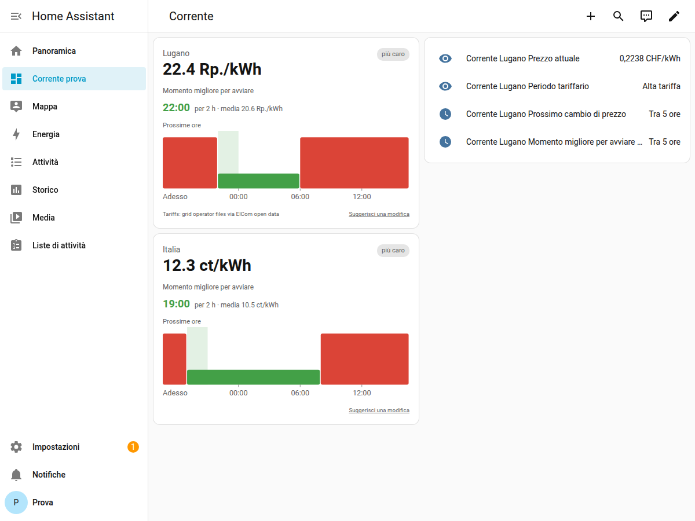

# Test a casa (owner) — inizio novembre 2026

> Scopo: provare Corrente come lo userà una persona vera, sul tuo computer, con **la tua tariffa**.
> Tempo: circa 45 minuti la prima volta (di cui 15–20 di attesa mentre Home Assistant si installa).
> Non serve saper programmare. Se qualcosa non va, **fermati e scrivimi in chat** cosa vedi (anche una foto dello schermo va benissimo).

Tutto succede in una "macchina virtuale": un computer finto dentro il tuo. Non tocca nulla del resto del computer e alla fine si cancella con un clic.

**Basta il tuo laptop**, non serve un apparecchio dedicato. Ti servono circa **8 GB di RAM** (Home Assistant ne usa 2) e **35 GB liberi** sul disco. Finché il test gira, il laptop deve restare **acceso, collegato alla corrente e senza sospensione** (Windows: Impostazioni → Sistema → Alimentazione → Sospensione: **Mai**). Se lo chiudi o va in sospensione, Home Assistant si ferma; riparte quando riavvii la macchina virtuale.

---

## Parte 1 — Installare Home Assistant (circa 25 minuti)

Le istruzioni ufficiali, sempre aggiornate:
- **Windows:** <https://www.home-assistant.io/installation/windows>
- **Mac:** <https://www.home-assistant.io/installation/macos>

Riassunto di cosa fare (ottobre 2026, Home Assistant OS 18.3):

1. Installa **VirtualBox** (gratuito): <https://www.virtualbox.org/wiki/Downloads>.
2. Scarica l'immagine di Home Assistant dalla pagina ufficiale qui sopra:
   - Windows o Mac con processore Intel: il file **VirtualBox (Intel)**, `haos_ova-….vdi.zip`;
   - Mac con processore Apple (M1, M2, M3, M4): il file `haos_generic-aarch64-….vdi.zip`.
   Poi **estrai lo zip**: ottieni un file `.vdi`.
3. In VirtualBox crea una **nuova macchina virtuale**:
   - nome: `Home Assistant`; tipo **Linux**, versione **Oracle Linux (64-bit)** (su Mac Apple: **Oracle Linux ARM 64-bit**);
   - memoria **2048 MB** (o di più), processori **2**;
   - spunta **Abilita EFI** (senza, non parte);
   - disco: **non** crearne uno nuovo; dopo, nelle impostazioni della macchina → **Archiviazione**, togli il disco vuoto e aggiungi il file `.vdi` che hai estratto;
   - **Rete** → "Connessa a": **Scheda con bridge** (Bridged Adapter), e scegli la rete che usi (Wi‑Fi o cavo).
4. Avvia la macchina e **aspetta circa 15–20 minuti**.
   Se VirtualBox dice che la virtualizzazione (VT-x / AMD-V) non è disponibile, va attivata nel BIOS del laptop: scrivimi marca e modello e ti dico dove.
5. Nel browser apri <http://homeassistant.local:8123>. Se non si apre, nella finestra nera della macchina virtuale c'è scritto l'indirizzo (tipo `http://192.168.1.50:8123`): usa quello.
   Se nella finestra nera non compare nessun indirizzo (succede con alcuni Wi‑Fi): spegni la macchina, nelle impostazioni → **Rete** scegli l'altra scheda di rete dell'elenco (o collega il cavo) e riavviala. Se ancora niente, fermati e scrivimi.
6. Crea l'utente come ti chiede Home Assistant. Alla domanda sulla posizione scegli **la tua casa** (serve per il fuso orario).

## Parte 2 — Installare Corrente (circa 10 minuti)

La repo è ancora privata, quindi HACS non può scaricarla: la copiamo a mano.

1. In Home Assistant: **Impostazioni → App → Samba share → Installa**. (Le "App" una volta si chiamavano "Add-on".)
2. Scheda **Configurazione**: scegli un nome utente e una password qualsiasi, **Salva**. Scheda **Informazioni**: **Avvia**.
3. Sul tuo computer apri la cartella condivisa:
   - **Windows:** in Esplora file, nella barra in alto scrivi `\\homeassistant.local` (o `\\` più l'indirizzo del punto 5 della parte 1);
   - **Mac:** Finder → **Vai → Connessione al server…** → `smb://homeassistant.local`.
   Inserisci il nome utente e la password del punto 2.
4. Scarica `corrente.zip` dalla release: <https://github.com/MichaelPito/ha-corrente/releases/latest> (devi essere collegato a GitHub). Estrailo.
5. Nella cartella condivisa apri **config**. Se non c'è, crea la cartella **custom_components**, e dentro una cartella **corrente**. Copia **tutto il contenuto** dello zip estratto dentro `config/custom_components/corrente/` (ci devono finire, tra gli altri, `manifest.json` e la cartella `frontend`).
6. Per il blueprint (facoltativo, parte 4): apri <https://github.com/MichaelPito/ha-corrente/blob/main/blueprints/automation/corrente/start_at_best_time.yaml>, pulsante **Download raw file**, e copia il file in `config/blueprints/automation/corrente/` (crea le cartelle se mancano).
7. In Home Assistant: **Impostazioni → Sistema → Riavvia** (in alto a destra) → **Riavvia Home Assistant**.

## Parte 3 — Configurare e controllare (circa 10 minuti)

1. **Impostazioni → Dispositivi e servizi → Aggiungi integrazione → Corrente**.
2. Scegli **Svizzera**, scrivi **il tuo comune**, scegli **la tua tariffa** come sulla bolletta. Corrente propone la tariffa di rete e i tributi: se non sei sicuro, lascia quelli proposti.
3. Apri il dispositivo Corrente e controlla, rispondendo alle domande qui sotto.
4. **Ricarica la pagina** del browser (tasto F5, o ⌘R sul Mac), poi aggiungi la card: in una dashboard **Modifica → Aggiungi scheda** → cerca **Corrente**. Dovresti vedere qualcosa così (prova fatta da Claude su Home Assistant 2026.2, Lugano e un contratto italiano biorario):

   
5. Se ti va, aggiungi anche una seconda configurazione **Italia** (per esempio un contratto biorario inventato) per vedere che funziona anche quella.

### Le domande (rispondimi in chat, bastano poche parole)
1. Sei riuscito a installare tutto? Dove ti sei bloccato, se ti sei bloccato?
2. Il tuo **comune** e il tuo **gestore** sono stati trovati da soli?
3. La **tariffa** che hai in bolletta era nell'elenco? Si capiva quale scegliere?
4. Il **prezzo adesso** (sensore "Prezzo attuale") ti sembra giusto rispetto alla bolletta? (La bolletta di solito ha i prezzi **senza IVA**; Corrente li mostra **con IVA**, quindi è normale che sia circa l'8% più alto.)
5. La **fascia** (alta/bassa) e l'**orario del prossimo cambio** corrispondono a quelli del tuo contratto?
6. La **card** si vede bene, nella tua lingua? Il "momento migliore" ha senso?
7. Apri **Corrente** nella barra laterale (la guida): si capisce? Ti ha aiutato, o manca qualcosa?
8. Qualcosa ti è sembrato **difficile, strano o brutto**? Qualsiasi cosa.
9. Una **foto dello schermo** della card e del dispositivo Corrente.

Se qualcosa non funziona: **Impostazioni → Sistema → Registri**, cerca `corrente`, e incollami quello che compare. Non incollare password o il numero cliente della bolletta.

## Parte 4 — Facoltativa: il blueprint (circa 5 minuti)
1. **Impostazioni → Dispositivi e servizi → Aiutanti → Crea aiutante → Interruttore** (si chiamerà per esempio `input_boolean.pronto`).
2. Serve anche un interruttore che faccia da "lavastoviglie": **Crea aiutante → Template → Interruttore**, nome `Lavastoviglie finta`, lascia vuoto il resto e salva.
3. **Impostazioni → Automazioni e scene → Blueprint → "Corrente — start an appliance at the cheapest time" → Crea automazione**: scegli il sensore "momento migliore", l'aiutante "pronto" e la "Lavastoviglie finta".
4. Accendi `pronto`: al momento migliore la lavastoviglie finta si accende da sola e `pronto` si spegne. (Puoi controllarlo il giorno dopo.)

## Alla fine
Puoi lasciare la macchina virtuale accesa qualche giorno per vedere i cambi di fascia, oppure spegnerla. Per cancellare tutto: in VirtualBox, tasto destro sulla macchina → **Rimuovi → Elimina tutti i file**.

---

### Note per Claude
- **Prova generale fatta l'8 ottobre 2026** su un Home Assistant 2026.2.3 vero (con interfaccia web), con dati reali: Lugano/AIL giorno-notte, AIL "dinamica", Italia bioraria, PUN dal GME. Funziona tutto; nessun avviso nel registro. Trovati e corretti tre problemi (vedi `PIANO.md`, 8 ottobre). All'owner restano solo le cose che non posso vedere da qui: la sua tariffa reale, la sua rete, il suo computer, la sua impressione.
- La riga della fonte svizzera sulla card ora è nella lingua di chi guarda (9 ottobre).
- **13 ottobre:** provato anche su Home Assistant 2026.10.1 (la versione che l'owner installerà). Trovato e corretto un errore con due o più configurazioni dopo un riavvio (parte 3, punto 5): il test a casa va fatto con l'ultima release (oggi v0.2.2).
- **16 ottobre:** l'owner farà il test sul suo laptop Windows (decisione sua), non su un apparecchio dedicato.
- Dopo il test: ogni problema diventa una richiesta su GitHub; le correzioni escono nella release successiva (v0.2.3).
